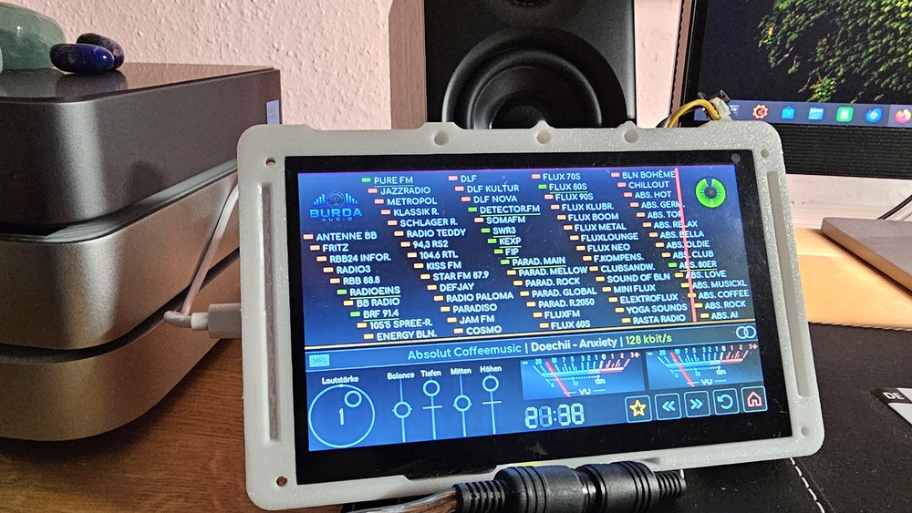
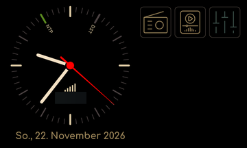
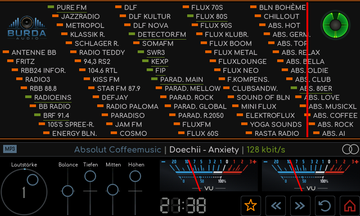
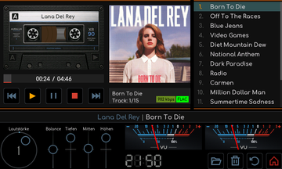

# RetroRadioCrowPanelS3

[Dokumentation](#dokumentation) | [Erstinstallation](docs/RetroRadioCrowPanelS3-Ersteinrichtung.md) | [Bedienung](docs/Bedienung.md) | [Radio und Musik](docs/Radio-und-Musik.md) | [Gerät und Anschlüsse](docs/Geräte-und-Anschlüsse.md)

Ein Internetradio im Stil eines klassischen Tischradios für das **Elecrow CrowPanel 7.0″ ESP32-S3**, Modell **DIS08070H**, mit 800 × 480 Pixeln. Dazu gehören ein SD-Musikplayer mit animierter Kassette, acht Audioanzeigen, Uhr, Touch-Einstellungen und eine Weboberfläche.

> **Hinweis zur Weiterentwicklung:** Das Display war eine Leihgabe. Vielen Dank an **Jupp**, der dieses Projekt damit ermöglicht hat! Das Gerät steht inzwischen nicht mehr für die Entwicklung zur Verfügung. Änderungen können deshalb kaum bis gar nicht mehr am tatsächlichen Display erprobt werden. Eine weitere Entwicklung für dieses Modell ist nur sehr eingeschränkt möglich. Der veröffentlichte Stand bleibt zur eigenen Nutzung und Weiterentwicklung verfügbar.

## Start-PIN: 0000

**Vier Nullen: 0 · 0 · 0 · 0.** Tippe auf den Sperrbildschirm, gib **0000** ein und bestätige mit **ok**. Bei der ersten Einrichtung gilt diese PIN auch für die Weboberfläche. Ändere sie anschließend unter **Einstellungen -> Sicherheit**. Hast Du bereits eine eigene PIN gespeichert, gilt diese weiter. [Zur PIN-Anleitung](docs/Bedienung.md#pin-sperre).

[](docs/bilder/geraet/crowpanel-s3.jpg)

Herstellerunterlagen: [Elecrow-Wiki zum CrowPanel ESP32 HMI 7.0″, DIS08070H](https://www.elecrow.com/wiki/esp32-display-702727-intelligent-touch-screen-wi-fi26ble-800480-hmi-display.html). Dort sind Pinbelegung, Versionshinweise, Schaltpläne und weitere Ressourcen verlinkt.

[Erste Inbetriebnahme](docs/RetroRadioCrowPanelS3-Ersteinrichtung.md) · [Bedienung](docs/Bedienung.md) · [Radio und Musik](docs/Radio-und-Musik.md) · [Weboberfläche](docs/Weboberfläche.md)

## Ein Blick auf die Oberfläche

| Hauptmenü | Radio | SD-Player |
| --- | --- | --- |
| [](docs/bilder/bedienung/hauptmenue.png) | [](docs/bilder/bedienung/radio-uebersicht.png) | [](docs/bilder/bedienung/sdplayer-wiedergabe.png) |

Die Bilder stammen vom Display. Ein Klick öffnet die volle Aufnahme mit 800 × 480 Pixeln. Private Netzwerkangaben sind unkenntlich gemacht. Gerät und Weboberfläche können unter **Einstellungen -> Allgemein -> Sprache** zwischen Deutsch und Englisch umgeschaltet werden. Die Anleitungen sind deutsch.

## Was enthalten ist

- Radio mit 70 Senderplätzen, Favoriten, analoger Senderskala und vier magischen Augen.
- SD-Player mit Titelliste, Coveranzeige, acht Kassettenmotiven, Wiederholung und Spulfunktion.
- Acht Visualisierungen mit je zwei Darstellungen, gemeinsam für Radio und SD-Player.
- Analoge und digitale Uhr, Zeitabgleich über WLAN und eine optionale externe DS1307.
- Drei Farbthemen, Helligkeit, feste Drehung um 180°, Zeitfenster und Sleep-Timer.
- Gemeinsame PIN-Sperre für Display und Weboberfläche.
- Webportal mit Radiosteuerung, Senderverwaltung, Dateimanager, FTP und Bildschirmaufnahme.

Die Tonausgabe erfolgt über einen NS4168 an einem Lautsprecheranschluss in **Mono**. Es gibt weder Bluetooth-Audio noch einen UKW-Sender, Kopfhöreranschluss oder automatische Lageerkennung.

## Dokumentation

| Thema | Anleitung |
| --- | --- |
| Installieren und aktualisieren | [Windows, Linux und macOS mit VS Code/PlatformIO](docs/RetroRadioCrowPanelS3-Ersteinrichtung.md), [PDF herunterladen](docs/RetroRadioCrowPanelS3-Ersteinrichtung.pdf) |
| Gerät bedienen | [Hauptmenü, Einstellungen, PIN und Zeitfenster](docs/Bedienung.md) |
| Radio und SD-Musik | [Sender, Klang, Anzeigen, Titelliste und Cover](docs/Radio-und-Musik.md) |
| Browser und Dateien | [Weboberfläche und FTP](docs/Weboberfläche.md) |
| Hardware | [Gerät und Anschlüsse](docs/Geräte-und-Anschlüsse.md) |
| Probleme eingrenzen | [Fehlerhilfe](docs/Fehlerhilfe.md) |
| Stand und Herkunft | [Änderungen](docs/Änderungen.md), [Lizenzen und Herkunft](docs/LIZENZEN.md) |

## Quellcode bauen

Vorausgesetzt sind PlatformIO und Git. Die Boarddefinition und alle Build-Einstellungen liegen im Projekt. Für das normale Gerät genügt:

```sh
pio run -e crowpanel7
```

Die ausführliche [Installationsanleitung](docs/RetroRadioCrowPanelS3-Ersteinrichtung.md) beschreibt auch das Übertragen über USB. `crowpanel7_dev` ist die zusätzliche Umgebung mit serieller Fernsteuerung und Zeitdiagnose. Für die normale Nutzung ist sie nicht erforderlich.

Unter **Windows** wählst Du am besten einen kurzen Projektpfad wie `C:\RRS3` oder `V:\RRS3`. Hinweise zu [langen Windows-Pfaden](docs/RetroRadioCrowPanelS3-Ersteinrichtung.md#windows-pfad-oder-dateiname-zu-lang) sowie zu [LZMA unter macOS](docs/RetroRadioCrowPanelS3-Ersteinrichtung.md#macos-python-meldet-fehlende-lzma-unterstützung) und dem [macOS-Treiber](docs/RetroRadioCrowPanelS3-Ersteinrichtung.md#macos-ch340-treiber-installieren-und-freigeben) stehen in der Anleitung.

Festgelegt sind pioarduino **55.03.37**, Arduino-ESP32 **3.3.7**, LovyanGFX **1.2.36** und [audio-lite **v0.2.0**](https://github.com/DIYLAB-DE/audio-lite/tree/v0.2.0). Die Audio-Bibliothek wird über `https://github.com/DIYLAB-DE/audio-lite.git#v0.2.0` bezogen. Der Tag zeigt auf `f9eac26ea15d2faede3a1d3916d5a153ee6159da`. Es gibt keine zusätzliche lokale Kopie dieser Bibliothek.

## Lizenz

Der Projektcode steht unter der [GNU GPL Version 3](LICENSE). Fremde Bestandteile behalten ihre jeweiligen Lizenzbedingungen und Urhebervermerke, siehe [Lizenzen und Herkunft](docs/LIZENZEN.md). Musikdateien sind nicht enthalten.

[Dokumentation](#dokumentation) | [Erstinstallation](docs/RetroRadioCrowPanelS3-Ersteinrichtung.md) | [Bedienung](docs/Bedienung.md) | [Radio und Musik](docs/Radio-und-Musik.md) | [Gerät und Anschlüsse](docs/Geräte-und-Anschlüsse.md)
