# Bedienung

[RetroRadioCrowPanelS3](../README.md) > [Dokumentation](../README.md#dokumentation) > Bedienung

## Hauptmenü und Uhr

Die drei großen Symbole öffnen **Radio**, **SD-Player** und **Einstellungen**. Links stehen Uhrzeit, Datum, WLAN-Empfang und IP-Adresse. Die Uhr im Hauptmenü ist analog.

Ohne WLAN-Verbindung bleibt das Radiosymbol gesperrt. Den SD-Player und die Einstellungen kannst Du auch ohne WLAN öffnen. Zum Einrichten des Netzes führt Dich die [Erste Inbetriebnahme](RetroRadioCrowPanelS3-Ersteinrichtung.md#9-erster-start-und-grundeinstellungen).

[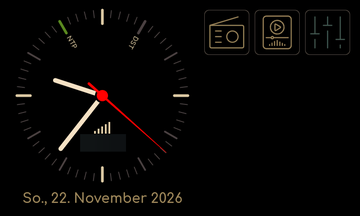](bilder/bedienung/hauptmenue.png)

Die Uhr wird über NTP gestellt, sobald WLAN und Zeitserver erreichbar sind. Eine optionale DS1307 hält die Zeit auch ohne Netzversorgung. **NTP** kennzeichnet eine bestätigte Synchronisation, **DST** die Sommerzeit. Die Zeitzone stellst Du unter **Zeit & Zeitserver** ein.

## Einstellungen

Links wählst Du die Seite, rechts bearbeitest Du deren Werte. **speichern** übernimmt Änderungen. Das Haus führt zurück zum Hauptmenü. Bei ungespeicherten Änderungen fragt ein Dialog, ob Du speichern oder verwerfen möchtest. Einige unmittelbar wirksame Schalter, etwa PIN-Sperre, serielle Protokolle und Sekundenzeiger, werden direkt übernommen.

| Seite | Aufgabe | Aufnahme |
| --- | --- | --- |
| WLAN | Drei Profile, Netzsuche, Passwort, Verbindungstest und Netzwerkname | [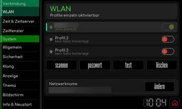](bilder/bedienung/einstellungen-wlan.png) |
| Zeit & Zeitserver | Zeitzone, Zeitserver, Synchronisationsabstand und manuelle Zeit | [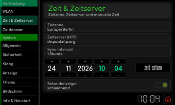](bilder/bedienung/einstellungen-zeit.png) |
| Zeitfenster | Betriebszeiten nach Wochentag und Stunde | [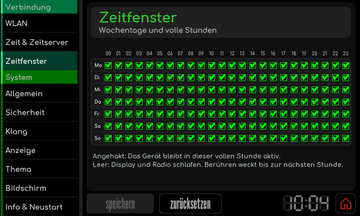](bilder/bedienung/einstellungen-zeitfenster.png) |
| Allgemein | Deutsch/Englisch und serielle Protokolle | [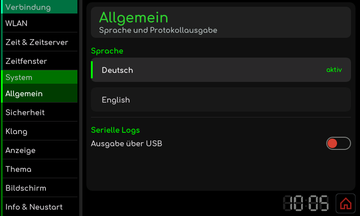](bilder/bedienung/einstellungen-allgemein.png) |
| Sicherheit | PIN-Sperre und vierstelliger Code | [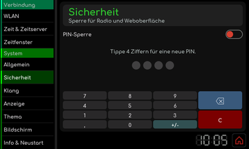](bilder/bedienung/einstellungen-sicherheit.png) |
| Klang | Klangfilter, Loudness und Lautsprecherausgabe | [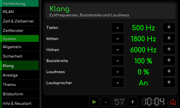](bilder/bedienung/einstellungen-klang.png) |
| Anzeige | Magisches Auge, VU-Trägheit und Bezugspegel | [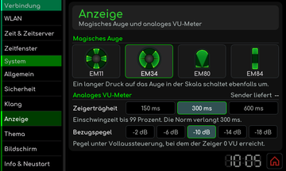](bilder/bedienung/einstellungen-anzeige.png) |
| Thema | Retro, E-Paper oder Individuell | [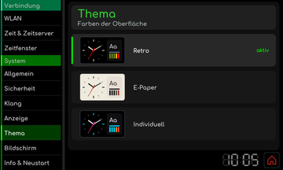](bilder/bedienung/einstellungen-thema.png) |
| Bildschirm | Helligkeit und feste Drehung um 180° | [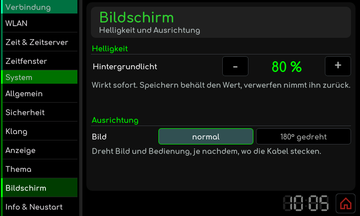](bilder/bedienung/einstellungen-bildschirm.png) |
| Info & Neustart | Geräte- und Netzwerkdaten, RTC-Erkennung, Neustart und Zurücksetzen | [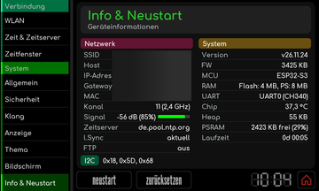](bilder/bedienung/einstellungen-info.png) |

### WLAN

Wähle ein Profil und tippe auf **scannen**. Wähle ein gefundenes Netz, gib über **passwort** dessen Passwort ein und probiere **test**. Aktiviere das Profil und speichere es. Beim Start werden die eingeschalteten Profile der Reihe nach versucht. Das Gerät unterstützt WLAN im 2,4-GHz-Band.

Der **Netzwerkname** bezeichnet das Gerät im Heimnetz. Seine Vorgabe enthält eine kurze Gerätekennung, damit mehrere Geräte verschieden heißen. In den Aufnahmen sind SSID, Gerätekennung und Adressen unkenntlich gemacht. Ein Verbindungstest allein ersetzt das Speichern des Profils nicht.

### Zeit und Zeitfenster

Wähle eine passende Zeitzone, etwa **Europe/Berlin**, damit Sommer- und Winterzeit berücksichtigt werden. Ein erreichbarer Zeitserver stellt die Uhr regelmäßig nach. Eine manuell gesetzte Uhrzeit kann der nächste NTP-Abgleich wieder korrigieren.

Unter **Zeitfenster** legst Du erlaubte Betriebsstunden für die Wochentage fest. Ein gesetztes Häkchen erlaubt den Betrieb in dieser Stunde. Außerhalb dieser Zeiten werden Wiedergabe und Display abgeschaltet. Eine Berührung weckt das Gerät bis zur nächsten vollen Stunde, dann wird das Zeitfenster erneut ausgewertet. Beim Aufwecken greift gegebenenfalls die PIN-Sperre. Zeitfenster setzen eine gültige Uhrzeit voraus. Der [Sleep-Timer](Radio-und-Musik.md#haus-taste-und-sleep-timer) beendet dagegen eine einzelne Wiedergabesitzung nach der gewählten Dauer.

### Allgemein

Wähle **Deutsch** oder **English**, tippe auf **speichern** und bestätige den Neustart. Die Sprache gilt anschließend für Display und Weboberfläche. Der Sekundenzeiger lässt sich zwischen schleichender Bewegung und Sekundenschritten umstellen. Diese Wahl sowie die Schalter für serielle Protokolle werden sofort gespeichert, ohne Neustart.

### Klang und Anzeige

**Loudness** hebt bei geringer Lautstärke Tiefen und Höhen an. Die Eckfrequenzen bestimmen die Arbeitspunkte der drei Klangregler. **Lautsprecher** schaltet die Tonausgabe ein oder aus. Das Gerät hat einen Mono-Lautsprecheranschluss. Die sichtbare **Basisbreite** erzeugt dort kein Stereobild.

Unter **Anzeige** wählst Du das magische Auge sowie die Trägheit und Empfindlichkeit der analogen VU-Meter. Die eigentliche Lautstärke und die Klangpegel verstellst Du direkt im Radio oder SD-Player.

Klangänderungen kannst Du über die Hörprobe direkt vergleichen. Sie wirken zunächst als Vorschau. **speichern** übernimmt den neuen Stand, **verwerfen** beim Verlassen stellt die gespeicherten Werte wieder her.

### Thema und Bildschirm

**Retro** verwendet einen dunklen Grund und warme Akzente. **E-Paper** verwendet einen hellen Grund. **Individuell** lässt sich über die [Weboberfläche](Weboberfläche.md#thema-und-farben) einfärben. Das Display zeigt zu jedem Thema eine kleine Vorschau. Eine Themenänderung wird gespeichert und nach einem Neustart wirksam.

Die Helligkeit reicht von 10 bis 100 Prozent. Die Ausrichtung ist wahlweise normal oder um 180° gedreht. Es gibt keine automatische Drehung durch einen Lagesensor.

Helligkeit und Drehung werden unmittelbar als Vorschau sichtbar. Speichere die gewünschte Einstellung. Verwirfst Du den Entwurf beim Verlassen, kehrt die Anzeige zum gespeicherten Stand zurück.

## PIN-Sperre

> **Start-PIN: 0000 – vier Nullen (0 · 0 · 0 · 0).** Sie gilt bei einer frischen Einrichtung für Display und Weboberfläche. Eine selbst festgelegte PIN bleibt bei einem Update erhalten.

Die PIN-Sperre ist zunächst eingeschaltet. Ändere die Start-PIN nach der Einrichtung. Zum Entsperren tippst Du auf den Sperrbildschirm, gibst die vier Ziffern ein und bestätigst mit **ok**. **c** löscht die Eingabe.

Im Hauptmenü kannst Du das Display durch eine diagonale Wischgeste in eine der beiden linken Ecken oder aus einer solchen Ecke heraus sperren. Nach dem Start und beim Aufwecken aus einem Zeitfenster wird die eingeschaltete PIN-Sperre ebenfalls aktiv.

Die Sicherheitsseite verlangt beim Abschalten der Sperre den bisherigen Code. Eine geänderte PIN gilt anschließend auch für die Weboberfläche. Behalte den Code an einem sicheren Ort. Die Sperre schützt die Bedienung, sie ersetzt keine Netzwerkabsicherung.

Zum Ändern der PIN öffnest Du den PIN-Dialog, gibst vier neue Ziffern ein und wiederholst sie zur Bestätigung. Übernimm die Änderung mit **speichern**. Wenn Du die Sperre später wieder einschaltest, gilt die zuletzt gespeicherte PIN.

## Neustart und Zurücksetzen

**Info & Neustart** zeigt unter anderem Firmwareversion, Speicher, Netzwerkdaten und die gefundenen I2C-Adressen. Die Zeile **FTP** zeigt „aus“ oder bei eingeschaltetem FTP die Adresse, zum Beispiel `ftp://crow@192.168.178.123`. Eine angeschlossene DS1307 erscheint als `0x68`. Weitere Angaben zur Uhr stehen unter [Gerät und Anschlüsse](Geräte-und-Anschlüsse.md#optionale-uhr).

Ein **Neustart** lädt den gespeicherten Zustand erneut. **Zurücksetzen** zeigt eine Bestätigungsfrage und setzt danach die Konfiguration einschließlich der WLAN-Profile und der PIN auf die Vorgaben zurück. Gelöscht werden dabei auch die gesicherten Radiowerte (Lautstärke, Klangregler, Senderwahl und Visualisierung), die eigenen Farben des Themas Individuell und das FTP-Passwort. Anschließend startet das Gerät neu. Die Senderliste bleibt erhalten, sie wird getrennt verwaltet. Zurücksetzen ist kein notwendiger Schritt bei einem normalen Firmwareupdate. Das Leeren einer SD-Titelliste ist davon unabhängig und entfernt keine Musikdateien von der Karte.

[RetroRadioCrowPanelS3](../README.md) > [Dokumentation](../README.md#dokumentation) > Bedienung
