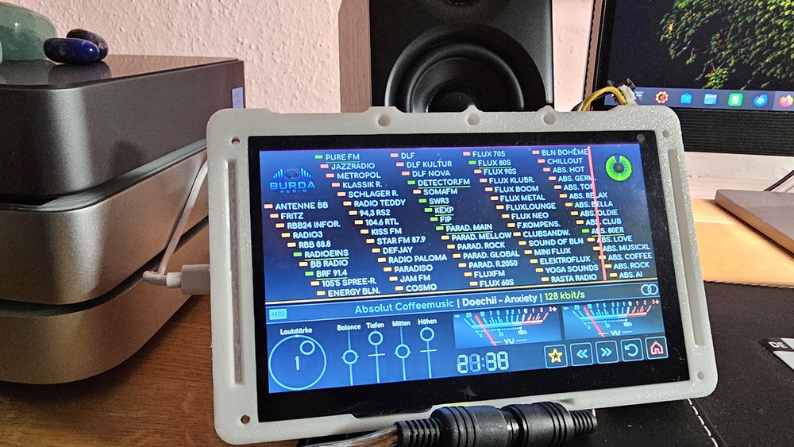
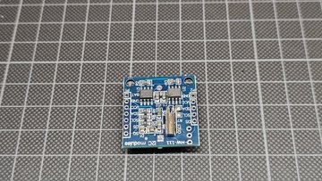
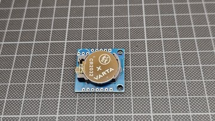

# Gerät und Anschlüsse

[RetroRadioCrowPanelS3](../README.md) > [Dokumentation](../README.md#dokumentation) > Gerät und Anschlüsse

Die Firmware ist für das **Elecrow CrowPanel 7.0″ ESP32-S3**, Modell **DIS08070H**, eingerichtet. Der bisher verwendete Platinenstand ist **V3.0**. Das Gerät war eine Leihgabe und steht für die weitere Entwicklung nicht mehr zur Verfügung, siehe [Projektstatus](../README.md).

## Ausstattung

| Merkmal | Verwendeter Stand |
| --- | --- |
| Prozessor | ESP32-S3, 240 MHz |
| Flash | 4 MB, Quad-SPI |
| PSRAM | 8 MB, Octal |
| Anzeige | 7,0″, 800 × 480 Pixel, RGB-Parallelbus |
| Touch | GT911, bei V3.0 Reset über PCA9557 |
| WLAN | Eingebaut, 2,4 GHz |
| Audio | NS4168, ein Lautsprecheranschluss, Mono |
| Speicherkarte | microSD über SPI, FAT32 |
| USB-Verbindung zum Rechner | CH340 an UART0 |
| Zusätzliche Uhr | DS1307 am I2C-Stecker, optional |

Maßgeblich für Stecker, Versorgung und den konkreten Platinenstand ist die [Herstellerdokumentation](https://www.elecrow.com/wiki/esp32-display-702727-intelligent-touch-screen-wi-fi26ble-800480-hmi-display.html). Auf dem Display läuft die Oberfläche nativ mit 800 × 480 Pixeln. Der RGB-Pixeltakt ist in dieser Firmware auf **12 MHz** eingestellt, die Bildrate liegt damit bei etwa 25,6 Bildern pro Sekunde.

## Strom, USB und Lautsprecher

Verwende eine stabile 5-V-Versorgung und ein geeignetes USB-Datenkabel zum Rechner. Ein reines Ladekabel stellt keine serielle Verbindung her. Nutze die vom Hersteller vorgesehenen Anschlüsse und halte Dich bei zusätzlicher Einspeisung an dessen Angaben.

Der Lautsprecher wird am **SPK-Anschluss** betrieben. Die Firmware mischt beide Audiokanäle zu Mono. **Balance** verändert dabei das Verhältnis der ursprünglichen linken und rechten Tonspur. **Basisbreite** hat auf die erzwungene Mono-Ausgabe keinen hörbaren Stereoeffekt.

Der Verstärker besitzt keine von der Firmware geschaltete Freigabeleitung. Bei **stumm** oder ausgeschalteten Lautsprechern werden Nullsamples ausgegeben. Lautstärke und Klang werden digital geregelt. Es gibt keinen Kopfhöreranschluss und keine automatische Kopfhörerumschaltung.

## microSD

Stecke eine mit **FAT32** formatierte microSD-Karte in den Kartenleser. Die Firmware bindet sie ein und erkennt auch das Entfernen. Während eines Uploads, einer Dateiübertragung oder laufender SD-Wiedergabe sollte die Karte nicht herausgezogen werden. Das Gerät formatiert Karten nicht selbst.

Der SD-Player und die Dateiübertragung teilen sich die Karte. Während eine Web-Dateiübertragung oder FTP sie belegt, kann die SD-Wiedergabe vorübergehend nicht starten. Schließe die Dateiverbindung und versuche es erneut.

## Optionale Uhr

Die externe **DS1307** wird an der **I2C-Buchse** angeschlossen. Sie hält die Uhrzeit mit einer Knopfzelle über das Ausschalten hinweg. Beim Start wird sie automatisch erkannt, eine Aktivierung in den Einstellungen ist nicht erforderlich. Nach einem erfolgreichen NTP-Abgleich wird auch die DS1307 gestellt. Ohne Zusatz kommt die Uhrzeit nach dem Start über WLAN vom Zeitserver.

Die Firmware nutzt außerdem den batteriegestützten Speicher der DS1307 für Senderwahl, Lautstärke, Balance, Klang, Stummschaltung und Visualisierungen. Diese Werte werden bei Änderungen unmittelbar aktualisiert. Ohne RTC erfolgt die Sicherung im Flash nach **fünf Sekunden ohne weitere Änderung**. Warte dann nach der letzten Änderung kurz, bevor Du die Stromversorgung trennst.

### Uhrenplatine vorbereiten

Die folgenden Bilder zeigen die **Tiny-RTC-Platine HW-111 mit DS1307** und eine **CR2032**. Die Aufnahmen der bereits dokumentierten Uhrenplatine werden hier mit Erlaubnis wiederverwendet.

1. **Diode D1 entfernen, bevor eine CR2032 eingesetzt wird.** D1 gehört zur Ladeschaltung für einen wiederaufladbaren LIR2032-Akku. Eine nicht wiederaufladbare CR2032 darf darüber nicht geladen werden.
2. Der zusätzliche **EEPROM U3** wird von dieser Firmware nicht genutzt. Er kann auf der Platine bleiben.
3. Eine vierpolige **HY2.0-/Grove-Buchse** an **SCL, SDA, VCC und GND** anlöten, in dieser Reihenfolge.
4. CrowPanel ausschalten. Die vorbereitete Uhr mit einem kurzen, **ungedrehten** Grove-Kabel an die **I2C-Buchse** anschließen. Kontakt 1 führt zu Kontakt 1, Kontakt 2 zu Kontakt 2 und so weiter.
5. Die CR2032 einsetzen und das Gerät einschalten. Unter **Einstellungen -> Info & Neustart** muss die I2C-Adresse **`0x68`** erscheinen. Der nächste Zeitabgleich stellt die Uhr.

| Bestückungsseite mit entfernter D1 | Batterieseite mit CR2032 |
| --- | --- |
|  |  |

### Verbindung an der I2C-Buchse

| Kontakt | Signal am S3 | DS1307-Platine | Übliche Kabelfarbe |
| --- | --- | --- | --- |
| 1 | SCL / IO20 | SCL | Gelb |
| 2 | SDA / IO19 | SDA | Weiß |
| 3 | 3,3 V | VCC | Rot |
| 4 | GND | GND | Schwarz |

Prüfe die Beschriftung und Kontaktfolge an Deiner Platine. Kabelfarben allein sind nicht verbindlich. Der Bus wird gemeinsam mit Touchcontroller und PCA9557 verwendet und arbeitet mit **100 kHz**.

Die Buchse liefert **3,3 V**. Der verwendete Aufbau funktioniert damit, der Betrieb liegt aber außerhalb des im [DS1307-Datenblatt angegebenen Versorgungsbereichs von 4,5 bis 5,5 V](https://www.analog.com/media/en/technical-documentation/data-sheets/DS1307.pdf). Das ist keine Zusage für beliebige DS1307-Module. Keine 5 V auf die I2C-Signalleitungen des S3 geben.

## Verwendete Signale

Diese Tabelle dient zum Verständnis des Quellcodes, nicht als Aufforderung, die Displayverdrahtung zu ändern.

| Funktion | GPIO |
| --- | --- |
| I2C SDA / SCL | 19 / 20 |
| I2S Daten / BCLK / LRCLK | 17 / 42 / 18 |
| SD MOSI / MISO / CLK / CS | 11 / 13 / 12 / 10 |
| UART0 TX / RX | 43 / 44 |
| Hintergrundlicht | 2 |
| RGB PCLK / DE / VSYNC / HSYNC | 0 / 41 / 40 / 39 |

Die vollständige RGB-Pinzuordnung liegt in `src/CrowPanelLgfx.cpp`, weitere Boardanschlüsse in `include/CrowPanelBoard.h`. Andere Auflösungen und Displaymodelle benötigen eigene Anpassungen und sind mit diesem Build nicht freigegeben.

[RetroRadioCrowPanelS3](../README.md) > [Dokumentation](../README.md#dokumentation) > Gerät und Anschlüsse
