# Radio und Musik

[RetroRadioCrowPanelS3](../README.md) > [Dokumentation](../README.md#dokumentation) > Radio und Musik

## Radio

Öffne das Radio über sein Symbol im Hauptmenü. Tippe auf einen Sendernamen in der Skala oder verwende die Pfeiltasten unten rechts. Der rote Zeiger fährt zur Auswahl, anschließend startet der Stream. Die Zeile unter der Skala zeigt Sender, Titel, Format und Bitrate, sofern der Sender diese Angaben liefert.

Es gibt **70 Senderplätze**. Bis zu zehn Favoriten sind in der Skala markiert. Der Stern öffnet die Favoritenauswahl. Namen, Streamadressen, Favoriten und Reihenfolge bearbeitest Du in der [Web-Senderverwaltung](Weboberfläche.md#radio-und-senderverwaltung).

Bricht ein Stream ab, versucht das Radio ihn automatisch wieder zu starten. Die Abstände steigen von zunächst zwei Sekunden bis auf 30 Sekunden. Bei einem dauerhaft nicht erreichbaren Stream prüfst Du die Adresse in der Senderverwaltung oder wählst einen anderen Sender.

## Lautstärke und Klang

Der Drehknopf links unten regelt die Lautstärke von 0 bis 100. Ziehe am äußeren Ring, um ihn zu drehen. Ein Tipp in die Mitte schaltet stumm beziehungsweise wieder ein. Die vier Schieberegler daneben steuern Balance, Tiefen, Mitten und Höhen. Halte einen Regler etwa **0,8 Sekunden** ruhig, um ihn in die Mitte zurückzusetzen. Der Kreispfeil setzt nach Rückfrage Lautstärke auf **30** sowie Balance und Klangregler auf ihre Mitte. Die Senderliste wird dadurch nicht gelöscht.

Das Gerät gibt **Mono** aus. Die Balance bestimmt das Mischungsverhältnis der ursprünglichen linken und rechten Tonspur. Die grundlegenden Klangfilter und Loudness stellst Du unter **Einstellungen -> Klang** ein. Beginne mit kleiner Lautstärke. Alle Radio- und SD-Aufnahmen in dieser Anleitung wurden mit **Lautstärke 1** erstellt.

## Haus-Taste und Sleep-Timer

Ein **kurzer Tipp auf das Haus** beendet die Wiedergabe und kehrt zum Hauptmenü zurück. Hältst Du das Haus **mindestens 0,8 Sekunden**, öffnet sich der Sleep-Timer. Zur Auswahl stehen **5, 15, 25, 45 und 60 Minuten**. **abbruch** schließt den Dialog, ohne einen Timer einzurichten. Ein laufender Timer lässt sich dort mit **stopp** beenden.

Das rote Häuschen **im Timerdialog** beendet die Wiedergabe sofort und führt zum Hauptmenü. Ohne Eingabe schließt der Dialog nach zehn Sekunden. Bei aktivem Timer zeigt die Uhr im Radio beziehungsweise SD-Player die verbleibende Zeit.

[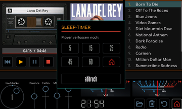](bilder/bedienung/sdplayer-sleeptimer.png)

Nach Ablauf enden Wiedergabe und Displayanzeige. Eine Berührung weckt das Gerät. Bei eingeschalteter PIN-Sperre folgt zuerst die Anmeldung. Radio und SD-Player verwenden dieselbe Bedienung der Haus-Taste.

## Acht Visualisierungen

Wische im Anzeigefeld rechts unten nach links oder rechts, um die Visualisierung zu wechseln. Halte den Bereich mindestens **0,8 Sekunden**, um zwischen den beiden Varianten des gewählten Modus umzuschalten. Radio und SD-Player teilen sich Modus und Varianten.

| Anzeige | Variante A | Variante B |
| --- | --- | --- |
| Analoges VU-Meter | [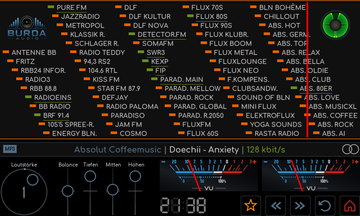](bilder/bedienung/radio-visualizer-analog-a.png) | [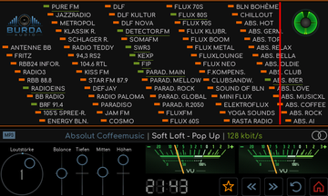](bilder/bedienung/radio-visualizer-analog-b.png) |
| Digitales VU-Meter | [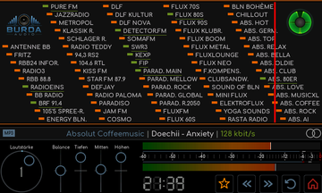](bilder/bedienung/radio-visualizer-digital-a.png) | [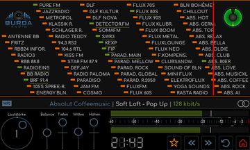](bilder/bedienung/radio-visualizer-digital-b.png) |
| Spektrum | [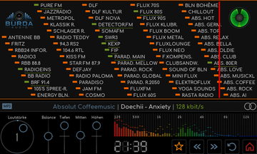](bilder/bedienung/radio-visualizer-spektrum-a.png) | [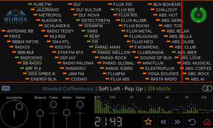](bilder/bedienung/radio-visualizer-spektrum-b.png) |
| Wellenform | [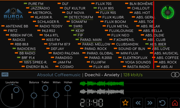](bilder/bedienung/radio-visualizer-welle-a.png) | [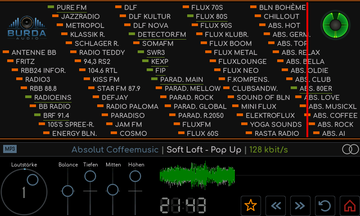](bilder/bedienung/radio-visualizer-welle-b.png) |
| Goniometer | [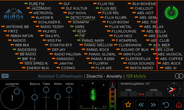](bilder/bedienung/radio-visualizer-goniometer-a.png) | [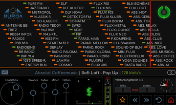](bilder/bedienung/radio-visualizer-goniometer-b.png) |
| Mittiges Spektrum | [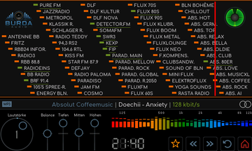](bilder/bedienung/radio-visualizer-mittig-a.png) | [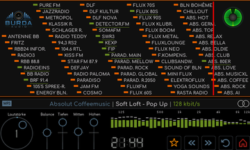](bilder/bedienung/radio-visualizer-mittig-b.png) |
| Wasserfall | [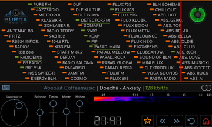](bilder/bedienung/radio-visualizer-wasserfall-a.png) | [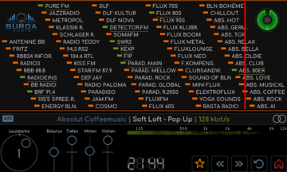](bilder/bedienung/radio-visualizer-wasserfall-b.png) |
| Nordlicht | [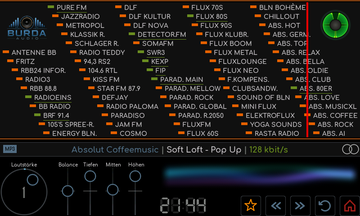](bilder/bedienung/radio-visualizer-nordlicht-a.png) | [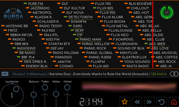](bilder/bedienung/radio-visualizer-nordlicht-b.png) |

Die Anzeigen werden vor Lautstärke und Klangregelung mit Audiodaten versorgt. Sie zeigen daher den Programmpegel, nicht die Lautstärke am Lautsprecher. **Stummschaltung und Lautstärke 0 setzen die Anzeigen auf null.** Bei fehlenden Audiodaten oder während der Senderumschaltung ruhen sie ebenfalls.

## Magisches Auge

Ein langer Druck auf das grüne Auge oben rechts wechselt zwischen **EM11, EM34, EM80 und EM84**. Dieselbe Wahl gibt es unter **Einstellungen -> Anzeige**. Die grafische Röhre zeigt nach der Senderwahl die WLAN-Signalstärke an. Stärkerer Empfang schließt das Auge beziehungsweise vergrößert das Leuchtband. Zwischen ungefähr −85 dBm und −55 dBm wächst der Ausschlag von null auf voll.

## SD-Player

Öffne den SD-Player über sein Symbol im Hauptmenü. Die Kassette, das Cover, die Titelliste und die Statuszeile gehören zur laufenden Musikdatei. Die fünf Tasten unter der Kassette sind **vorheriger Titel**, **Play**, **Pause**, **Stop** und **nächster Titel**. Ein Tipp auf einen Titel der Liste startet ihn. Radio und SD-Player spielen nie gleichzeitig.

Läuft der aktuelle Titel länger als drei Sekunden, springt **vorheriger Titel** zuerst an dessen Anfang. Ein weiterer kurzer Tipp wechselt zum vorherigen Titel. **Pause** hält die Wiedergabe an, ein weiterer Tipp auf Pause oder Play setzt sie fort. Lautstärke, Klang, Kreispfeil und Anzeigen bedienst Du wie im Radio.

Die Aufnahmen zeigen **Lana Del Rey, Born To Die**, von der vorhandenen Karte. Musikdateien sind nicht Bestandteil des Projekts. Eine Abbildung sagt nichts über die Verfügbarkeit des Albums oder eines Streams aus.

### Musik auswählen

Die Karte muss mit **FAT32** formatiert sein. Das Ordnersymbol unten öffnet die Dateiauswahl. Ein kurzer Tipp öffnet einen Ordner, **..** führt zurück. Längeres Drücken wählt eine Datei oder einen ganzen Ordner aus. Mit **ok** übernimmst Du die Auswahl in die Titelliste, **abbruch** schließt den Dialog ohne Übernahme.

Erneutes langes Drücken auf einen ausgewählten Eintrag hebt die Auswahl wieder auf. Unten im Dialog siehst Du die bisherige Auswahl. Bei einem Ordner werden zuerst seine Musikdateien alphabetisch gesammelt, danach die Titel seiner Unterordner.

| Ordner öffnen | Album auswählen | Auswahl übernehmen |
| --- | --- | --- |
| [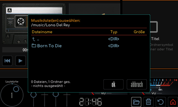](bilder/bedienung/sdplayer-lana-alben.png) | [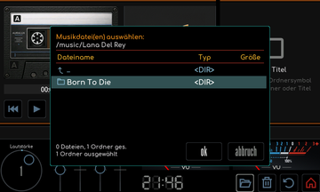](bilder/bedienung/sdplayer-ordner-ausgewaehlt.png) |  |

Die Dateiauswahl nimmt **MP3, AAC, M4A, FLAC und OGG** an. Enthaltene Decoder können weitere Audioformate unterstützen, daraus folgt nicht automatisch eine Auswahlmöglichkeit im Dateidialog. Je Auswahl kannst Du **einen Ordner oder bis zu 32 einzelne Dateien** übernehmen. Die Liste fasst höchstens **300 Titel**, Ordner werden bis **20 Ebenen** tief gesammelt. Ein Sammelauftrag ist zusätzlich auf 2000 gelesene Einträge beziehungsweise geöffnete Ordner begrenzt. Bereits enthaltene Dateien werden nicht nochmals hinzugefügt. Versteckte Verwaltungsdateien und unzulässige oder zu lange Pfade werden ausgelassen.

Der Papierkorb leert nach Rückfrage nur die **Titelliste**. Die Dateien auf der Karte bleiben erhalten. Längeres Halten von Vorwärts oder Rückwärts spult in Schritten, ein Tipp auf den Fortschritt springt innerhalb des Titels. Dafür muss die Wiedergabe laufen, die Dauer bekannt und die Datei suchbar sein. Während Pause ist Spulen nicht verfügbar.

### Wiederholen

| Modus | Bedienung |
| --- | --- |
| Einmal abspielen | Play startet die Liste. Im Retro-Thema ist die Taste orange. |
| Einen Titel wiederholen | Während normaler Wiedergabe kurz auf Play tippen. Die Taste wird grün. |
| Die gesamte Liste wiederholen | Play mindestens 0,8 Sekunden halten und loslassen. Die Taste wird rot. |

Ein kurzer Tipp auf Play bei aktiver Wiederholung während laufender Wiedergabe schaltet zurück auf normal. Pause und Titelsprünge behalten den Modus. Stop, das Leeren der Titelliste und das Verlassen des Players schalten die Wiederholung aus. Der Modus wird nicht dauerhaft gespeichert.

### Cover

Eine **`folder.jpg`** im selben Ordner hat Vorrang vor dem eingebetteten Cover. Groß- und Kleinschreibung des Namens sind beliebig. Fehlt ein nutzbares Ordnerbild, versucht der Player das eingebettete JPEG- oder PNG-Cover. PNG-Cover dürfen höchstens **500 × 500 Pixel** haben. Pro Bild gilt eine Obergrenze von **1 MB**.

`folder.jpg` gilt für alle Titel dieses Ordners. Nach einer `folder.png` sucht der Player nicht. Die Größenbegrenzung betrifft das Coverbild, nicht die gesamte Musikdatei.

Die Coverfläche ist **230 × 220 Pixel** groß. Das Bild wird ohne Verzerrung eingepasst und an überstehenden Rändern mittig beschnitten. Ein fehlendes oder nicht lesbares Cover unterbricht die Wiedergabe nicht, stattdessen erscheint der Platzhalter.

### Acht Kassettenmotive

Ein Tipp auf die Kassette wählt das nächste Motiv. Die Naben bewegen sich bei laufender Wiedergabe. Die Wickel folgen dem Fortschritt der gesamten Titelliste, wobei jeder Titel einen gleich großen Anteil erhält. Sie zeigen keine genaue Restspielzeit an. Ein Motivwechsel ändert die Titelliste nicht.

| Motiv 1 | Motiv 2 | Motiv 3 | Motiv 4 |
| --- | --- | --- | --- |
| [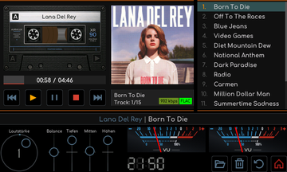](bilder/bedienung/sdplayer-kassette-1.png) | [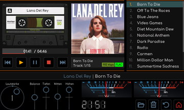](bilder/bedienung/sdplayer-kassette-2.png) | [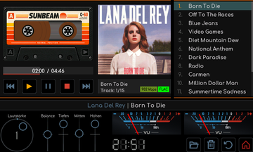](bilder/bedienung/sdplayer-kassette-3.png) | [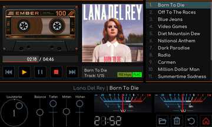](bilder/bedienung/sdplayer-kassette-4.png) |

| Motiv 5 | Motiv 6 | Motiv 7 | Motiv 8 |
| --- | --- | --- | --- |
| [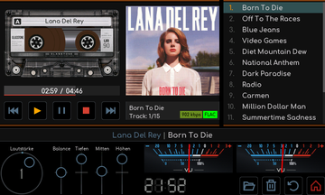](bilder/bedienung/sdplayer-kassette-5.png) | [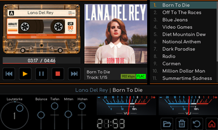](bilder/bedienung/sdplayer-kassette-6.png) | [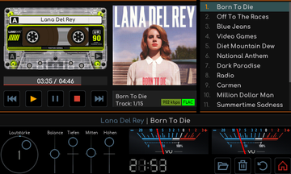](bilder/bedienung/sdplayer-kassette-7.png) | [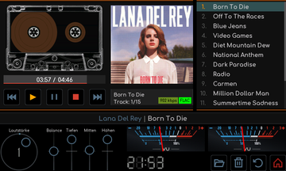](bilder/bedienung/sdplayer-kassette-8.png) |

Zum Kopieren von Musik kannst Du einen Kartenleser, den [Web-Dateimanager oder FTP](Weboberfläche.md#dateimanager-und-ftp) benutzen. Beende vorher die Wiedergabe und schließe die Dateiverbindung wieder, bevor Du den SD-Player startest.

[RetroRadioCrowPanelS3](../README.md) > [Dokumentation](../README.md#dokumentation) > Radio und Musik
