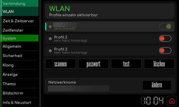
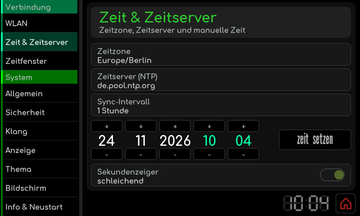

# RetroRadioCrowPanelS3: Erste Inbetriebnahme

[RetroRadioCrowPanelS3](../README.md) > [Dokumentation](../README.md#dokumentation) > RetroRadioCrowPanelS3: Erste Inbetriebnahme

Diese Anleitung führt Dich von der Vorbereitung des Rechners bis zum gestarteten RetroRadioCrowPanelS3. Sie gilt für das **Elecrow CrowPanel 7.0″ ESP32-S3, DIS08070H**, mit 4 MB Flash, 8 MB PSRAM und 800 × 480 Pixeln. Du bereitest das Projekt unter Windows, Linux oder macOS in Visual Studio Code mit PlatformIO vor und überträgst die Firmware über ein USB-C-Datenkabel. Danach kannst Du denselben Projektordner zum Lesen und Bearbeiten des Quellcodes und für spätere Aktualisierungen verwenden.

## Start-PIN: 0000

> **Vier Nullen: 0 · 0 · 0 · 0.** Tippe auf den Sperrbildschirm, gib **0000** ein und bestätige mit **ok**. Die Start-PIN gilt bei einer frischen Einrichtung für Display und Weboberfläche. Eine bereits gespeicherte eigene PIN bleibt bei einem Update erhalten. Ändern kannst Du sie unter **Einstellungen -> Sicherheit**.

**Stand: 24.11.2026.** Die Firmware wurde unter Linux gebaut und auf dem CrowPanel geprüft. Der Upload auf ein bereits eingerichtetes Gerät ist bestätigt. Ein vollständiger Durchlauf ab Werksfirmware sowie Durchläufe unter Windows und macOS stehen aus. Die beschriebenen Windows- und macOS-Schritte entsprechen dem üblichen PlatformIO-Ablauf und stützen sich auf die unten verlinkten offiziellen Anleitungen.

> Das Display war eine Leihgabe. Vielen Dank an **Jupp**, der das Projekt damit ermöglicht hat! Es steht inzwischen nicht mehr für die Entwicklung zur Verfügung. Weitere Änderungen können deshalb kaum bis gar nicht mehr an diesem Display erprobt werden.

> Die ab Werk installierte Demo von Elecrow wird durch RetroRadioCrowPanelS3 ersetzt, eine Zwischen-Firmware ist nicht erforderlich. Die Werksfirmware gibt es im Repository des Herstellers, siehe [Rückweg zur Werksfirmware](#rückweg-zur-werksfirmware).

## 1. Was Du brauchst

- Ein **Elecrow CrowPanel 7.0″ ESP32-S3, DIS08070H**, mit 800 × 480 Pixeln. Prüfe die Modellbezeichnung, siehe [Gerät und Anschlüsse](Geräte-und-Anschlüsse.md).
- Einen passenden Lautsprecher am Anschluss **SPK**. Die Tonausgabe ist mono.
- Ein USB-C-Datenkabel, passend zu Deinem Rechner. Ein reines Ladekabel reicht nicht.
- Eine stabile Versorgung mit **5 V und 2 A** für den Betrieb. Ein schwacher USB-Anschluss oder ein schlechtes Kabel kann Neustarts verursachen.
- Einen Rechner mit Windows, Linux oder macOS und Internetzugang für Werkzeuge und Projektabhängigkeiten.
- Visual Studio Code mit der Erweiterung PlatformIO IDE, Git und den vollständigen Projektordner.
- Ein WLAN im **2,4-GHz-Band** für Internetradio und Zeitabgleich.
- Für den SD-Player eine microSD-Karte mit **FAT32**. exFAT wird nicht unterstützt. Viele größere Karten sind ab Werk mit exFAT formatiert und müssen zuvor passend eingerichtet werden.
- Optional eine [Uhr DS1307](Geräte-und-Anschlüsse.md#optionale-uhr) für die Buchse **I2C**, vorbereitet wie unter [Uhrenplatine vorbereiten](Geräte-und-Anschlüsse.md#uhrenplatine-vorbereiten) beschrieben.

## 2. Visual Studio Code und PlatformIO einrichten

### Vorbereitung für Dein Betriebssystem

Installiere die Desktop-Ausgabe von [Visual Studio Code](https://code.visualstudio.com/download). Die folgenden Schritte werden in der lokal installierten Anwendung ausgeführt.

| Betriebssystem | Vorbereitung |
| --- | --- |
| Windows | Verwende das zu Deinem Rechner passende [VS-Code-Installationsprogramm](https://code.visualstudio.com/docs/setup/windows). Die Variante **User Setup** installiert VS Code für Dein Benutzerkonto. |
| Linux | Installiere das passende Paket gemäß der [VS-Code-Anleitung für Linux](https://code.visualstudio.com/docs/setup/linux), beispielsweise DEB unter Debian/Ubuntu oder RPM unter Fedora. Für PlatformIO werden Python 3 und die Unterstützung für virtuelle Python-Umgebungen benötigt, unter Debian/Ubuntu heißt das Zusatzpaket `python3-venv`. Installiere diese bei Bedarf über die Paketverwaltung Deiner Distribution. |
| macOS | Lade die passende Ausgabe für Deinen Mac herunter und verschiebe **Visual Studio Code.app** nach **Programme / Applications**. Die [VS-Code-Anleitung für macOS](https://code.visualstudio.com/docs/setup/mac) beschreibt die Installation. |

Installiere zusätzlich [Git für Dein Betriebssystem](https://git-scm.com/downloads). **Git wird auch bei einer ZIP-Kopie des Projekts benötigt**, weil PlatformIO die Audio-Bibliothek aus einem Git-Repository bezieht. Prüfe in einem neu geöffneten Terminal mit `git --version`, ob Git erreichbar ist. Falls Du Git gerade installiert hast, starte VS Code anschließend neu.

### PlatformIO installieren

1. Starte VS Code und öffne links **Erweiterungen / Extensions**.
2. Suche nach **PlatformIO IDE** und installiere die Erweiterung des Herausgebers **PlatformIO**.
3. Warte auf den Abschluss der Einrichtung und lade das VS-Code-Fenster neu, falls Du dazu aufgefordert wirst.

PlatformIO bringt seine Kommandozeilenwerkzeuge bereits mit. Für diesen Weg brauchst Du keine zusätzliche PlatformIO-Installation per `pip` oder Betriebssystempaket. Unter Linux nennt die [offizielle PlatformIO-Installationsanleitung](https://docs.platformio.org/en/latest/integration/ide/vscode.html#installation) außerdem `python3-venv` als Voraussetzung.

**macOS:** Meldet die Einrichtung fehlende LZMA-Unterstützung, beachte [Python meldet fehlende LZMA-Unterstützung](#macos-python-meldet-fehlende-lzma-unterstützung). Dort stehen der Hinweis zu `brew install xz` und die Prüfung des tatsächlich von PlatformIO verwendeten Python.

Die Menüs von VS Code können deutsch oder englisch heißen. PlatformIO verwendet überwiegend englische Bezeichnungen, diese sind hier so angegeben, wie sie in der Erweiterung stehen.

## 3. Das vollständige Projekt öffnen

### Unter Windows zuerst einen kurzen Zielpfad wählen

Lege das Projekt möglichst nahe am Laufwerksanfang ab, beispielsweise unter **`C:\RRS3`** oder **`V:\RRS3`**. Beim Bauen entstehen zusätzliche Unterordner und lange Dateinamen. Ein schon langer Benutzer- oder Projektpfad kann daher zu Pfadlängenfehlern führen. Das gilt für Klonen und ZIP-Download gleichermaßen.

Beim Klonen kannst Du direkt das Laufwerk als Ziel wählen. Soll der Projektordner kürzer heißen, benenne ihn danach vor dem Öffnen in VS Code in `RRS3` um. Eine entpackte ZIP-Kopie kannst Du ebenso umbenennen. Weitere Möglichkeiten stehen unter [Windows: Pfad oder Dateiname zu lang](#windows-pfad-oder-dateiname-zu-lang).

### Empfohlen: direkt in VS Code klonen

1. Öffne das [RetroRadioCrowPanelS3-Repository](https://github.com/DIYLAB-DE/RetroRadioCrowPanelS3) im Browser. Kopiere über **Code > HTTPS** die Repository-Adresse.
2. Öffne in VS Code über **Ansicht / View > Befehlspalette / Command Palette** die Befehlsauswahl.
3. Wähle **Git: Clone** und füge die kopierte HTTPS-Adresse ein.
4. Wähle einen lokalen Zielordner. Öffne nach dem Klonen das Projekt in VS Code.

Dieser Weg entspricht dem [Klonen eines vorhandenen Repositorys in VS Code](https://code.visualstudio.com/docs/sourcecontrol/repos-remotes#clone-repositories). Du erhältst eine vollständige lokale Arbeitskopie, die Du später auch bearbeiten und mit **Git: Pull** aktualisieren kannst.

### Alternative: ZIP herunterladen

Wähle im Repository **Code > Download ZIP**, entpacke das Archiv vollständig und öffne den entpackten Projektordner über **Datei / File > Ordner öffnen / Open Folder** in VS Code. Wähle den Ordner, in dem `platformio.ini` liegt. Bei einer ZIP-Datei heißt dieser Ordner üblicherweise `RetroRadioCrowPanelS3-master`.

### Den richtigen Ordner erkennen

Im Explorer von VS Code müssen unter anderem diese Einträge sichtbar sein:

| Eintrag | Inhalt |
| --- | --- |
| `platformio.ini` | Projekteinstellungen mit den Umgebungen `crowpanel7` und `crowpanel7_dev` und festen Versionen. |
| `src` | C++-Quelldateien der Firmware. |
| `include` | Zugehörige Header-Dateien, Schriften und Bilder. |
| `boards/crowpanel7-s3.json` | Boarddefinition mit 4 MB Flash und 8 MB PSRAM. |
| `partitions_crowpanel7.csv` | Aufteilung des Flashspeichers in Firmware, Einstellungen und Sender. |
| `lib/kissfft` | FFT-Bibliothek für die Audioanzeigen. audio-lite wird beim Build separat geladen. |
| `webui` | Quelle der Weboberfläche. |
| `scripts` | Für den Build benötigte Skripte zur Versionskennung und Weboberfläche. |

Öffne den vollständigen Projektordner, nicht nur eine einzelne Quelldatei oder den Unterordner `src`. Bestätige eine Vertrauensabfrage von VS Code für die von Dir bezogene und geprüfte Projektquelle. Warte anschließend, bis PlatformIO das Projekt erkannt und vorbereitet hat. Beim ersten Öffnen und Bauen werden weitere Pakete heruntergeladen. Build-Ergebnisse und Projektbibliotheken liegen unter `.pio`.

Zum Lesen oder Bearbeiten öffnest Du eine Datei im Explorer. Änderungen speicherst Du wie gewohnt in VS Code. Danach kannst Du die Firmware erneut bauen und übertragen. Für die Erstinstallation sind keine Änderungen am Quellcode, an den Bibliotheken oder an `platformio.ini` nötig. Insbesondere trägst Du keine WLAN-Zugangsdaten in Projektdateien ein, das WLAN richtest Du nach dem ersten Start am Gerät ein.

## 4. Die Firmware zunächst bauen

Es gibt zwei Projektumgebungen für dasselbe S3-Display:

| Umgebung | Verwendung |
| --- | --- |
| `crowpanel7` | Voreingestellte Firmware für den normalen Betrieb. Verwende diese Umgebung für die Installation. |
| `crowpanel7_dev` | Zusätzlicher Befehlseingang über UART0 und Audio-Zeitdiagnose für die Entwicklung. Für die normale Nutzung nicht erforderlich. |

Klicke links auf das PlatformIO-Symbol und öffne **Project Tasks**. Starte unter **crowpanel7 > General > Build** den Build. Dabei wird aus dem Quellcode die Firmware erstellt. Das CrowPanel muss hierfür noch nicht angeschlossen sein.

Alternativ öffnest Du über die Befehlspalette **PlatformIO: New Terminal** und gibst ein:

```text
pio run -e crowpanel7
```

PlatformIO lädt die festgelegten Werkzeuge und Bibliotheken, darunter **audio-lite v0.2.0**. Der erste Durchlauf kann wegen der Downloads mehrere Minuten dauern. Die [PlatformIO-Dokumentation zu Project Tasks](https://docs.platformio.org/en/latest/integration/ide/vscode.html#project-tasks) beschreibt die Aufgaben in der Erweiterung.

Warte auf **SUCCESS**. Bei einem Fehler liest Du zuerst die konkrete Fehlermeldung im Terminalbereich, nicht nur die abschließende Zusammenfassung. Fahre erst nach einem erfolgreichen Build mit der Übertragung fort.

## 5. Das CrowPanel anschließen

Der USB-C-Anschluss des Displays versorgt die Platine und verbindet den Rechner über den eingebauten USB-Seriell-Wandler **CH340** mit UART0. Anschlussbelegung und Platinenstände beschreibt das [Elecrow-Wiki zum DIS08070H](https://www.elecrow.com/wiki/esp32-display-702727-intelligent-touch-screen-wi-fi26ble-800480-hmi-display.html).

1. Verbinde die USB-C-Buchse des CrowPanel über das Datenkabel direkt mit dem Rechner.
2. Warte, bis das Betriebssystem den seriellen Anschluss erkannt hat.
3. Prüfe den neu hinzugekommenen Port, bevor Du den Upload startest.

Portnamen unterscheiden sich je nach Betriebssystem und Rechner:

| Betriebssystem | Anschluss erkennen | Treiber und Hinweise |
| --- | --- | --- |
| Windows | Im Geräte-Manager unter **Anschlüsse (COM & LPT)**, etwa `USB-SERIAL CH340 (COM5)`. | Falls das Gerät nur mit Warnzeichen erscheint, den Windows-Treiber **CH341SER** von [WCH](https://www.wch-ic.com/products/CH340.html) installieren. Danach neu verbinden. |
| Linux | Ein neuer Anschluss wie `/dev/ttyUSB0`. | Der Kernel-Treiber heißt `ch341`. Bei `Permission denied` die Geräteberechtigungen einrichten, siehe Abschnitt 11. |
| macOS | Ein Anschluss wie `/dev/cu.usbserial-...` oder `/dev/cu.wchusbserial...`. | Falls kein Port erscheint, den [WCH-Treiber und dessen Anleitung](https://github.com/WCHSoftGroup/ch34xser_macos) verwenden. Installation und Freigabe sind im folgenden Abschnitt beschrieben. |

Im PlatformIO-Terminal zeigt `pio device list` die verfügbaren Geräte. Ziehe bei unklarer Zuordnung das CrowPanel kurz ab und vergleiche die Liste nach dem erneuten Anstecken. Bei mehreren seriellen Geräten gibst Du den passenden Port ausdrücklich an, wie in Abschnitt 7 beschrieben.

### macOS: CH340-Treiber installieren und freigeben

Erscheint der Port bereits, ist keine zusätzliche Treiberinstallation nötig. Andernfalls bietet das [WCH-Repository ch34xser_macos](https://github.com/WCHSoftGroup/ch34xser_macos) Treiber für die CH340-Familie und weitere WCH-Bausteine. Das CrowPanel verwendet einen **CH340 an UART0**.

1. Lade für den beschriebenen DMG-Weg `CH34xVCPDriver.dmg` aus dem WCH-Repository herunter und öffne es. Beachte die dortigen Hinweise zur passenden Paketvariante für Deine macOS-Version.
2. Ziehe **CH34xVCPDriver** nach **Programme / Applications**.
3. Starte anschließend **die installierte App** und klicke auf **Install**. Das Kopieren der App allein installiert den Treiber noch nicht.
4. Erlaube die WCH-Treibererweiterung in den Systemeinstellungen. Unter aktuellem macOS findest Du sie unter **Allgemein -> Anmeldeobjekte & Erweiterungen -> Treiber**. Apple beschreibt diese [Einstellungen und Freigaben](https://support.apple.com/de-de/guide/mac-help/mtusr003/27/mac/27). Bei älteren Versionen kann die Freigabe unter **Datenschutz & Sicherheit** liegen.
5. Starte den Mac neu, falls die Installation es verlangt. Verbinde das Display erneut und prüfe `pio device list` im PlatformIO-Terminal oder `ls /dev/cu.*` im macOS-Terminal.

Ein Upload unter macOS ist mit diesem CrowPanel noch nicht bestätigt.

## 6. Was der Upload verändert

Das Projekt verwendet den gewöhnlichen PlatformIO-Upload mit **esptool**. Es werden Bootloader, Partitionstabelle und Firmware in den Flashspeicher des ESP32-S3 geschrieben und die übertragenen Daten geprüft. Das Board wird normalerweise automatisch in den Downloadmodus versetzt und danach neu gestartet.

Die Einstellungen einschließlich PIN und WLAN-Profilen liegen getrennt von der Firmware. Auch die Senderliste hat einen eigenen Bereich. Bei einem gewöhnlichen Update mit der unveränderten [Partitionstabelle](../partitions_crowpanel7.csv) bleiben diese Daten erhalten. Das wurde bei den Updates auf v26.11.22 und v26.11.24 geprüft. Dateien auf der SD-Karte werden durch den Upload nicht verändert.

Ein vollständiges Löschen des Flashspeichers würde die gespeicherten Einstellungen und Sender entfernen. Für die hier beschriebene Installation und spätere Updates ist ein solcher Löschschritt nicht vorgesehen. Sichere eine eigene Senderliste trotzdem vor einem Update über die [Weboberfläche](Weboberfläche.md#reihenfolge-und-sicherung).

## 7. RetroRadioCrowPanelS3 übertragen

Schließe offene serielle Monitore und andere Programme, die den gewählten Anschluss verwenden. Starte in **Project Tasks** unter **crowpanel7 > General > Upload** die Übertragung. Alternativ verwendest Du **PlatformIO: New Terminal**:

```text
pio run -e crowpanel7 -t upload
```

Dieses Terminal verwendet die mit PlatformIO eingerichteten Werkzeuge. Zur Kontrolle zeigt `pio --version` dort PlatformIO Core 6.1 oder neuer. Bei mehreren Geräten oder einer unklaren automatischen Portauswahl gibst Du den Anschluss an. Die folgenden Namen sind Beispiele und müssen zu Deinem Rechner passen:

**Windows:**

```text
pio run -e crowpanel7 -t upload --upload-port COM5
```

**Linux:**

```text
pio run -e crowpanel7 -t upload --upload-port /dev/ttyUSB0
```

**macOS:**

```text
pio run -e crowpanel7 -t upload --upload-port /dev/cu.wchusbserial1410
```

Eine optionale Datei `platformio_lokal.ini` im Projektordner kann den Anschluss für Deinen Rechner festhalten. Ersetze `COM5` durch Deinen tatsächlichen Port:

```ini
[env]
upload_port = COM5
monitor_port = COM5
```

Diese lokale Datei wird von Git ignoriert. Sie ändert keine gemeinsamen Build-Einstellungen.

Der Upload erkennt den ESP32-S3 und schreibt anschließend die Firmware. Warte auf **SUCCESS** und trenne währenddessen weder Strom noch USB. Danach startet das CrowPanel neu und zeigt bei eingeschalteter PIN-Sperre den Sperrbildschirm. Sollte der automatische Neustart ausbleiben, drücke kurz **RST**. Für den späteren Betrieb kannst Du das Display vom Rechner trennen und über ein geeignetes USB-Netzteil versorgen.

### Rückweg zur Werksfirmware

RetroRadioCrowPanelS3 sichert die Werksfirmware nicht. Elecrow verlinkt im [Wiki unter Resources](https://www.elecrow.com/wiki/esp32-display-702727-intelligent-touch-screen-wi-fi26ble-800480-hmi-display.html#resources) das [Herstellerrepository für das 7-Zoll-S3-Display](https://github.com/Elecrow-RD/CrowPanel-7.0-HMI-ESP32-Display-800x480) mit Beispielen und Werksdateien. Wähle dort die Dateien und Anleitung für Deinen Platinenstand. Dieser Rückweg wurde im Rahmen des Projekts nicht praktisch geprüft.

## 8. Spätere Updates

Für jedes weitere Update verwendest Du denselben Weg:

1. Sichere Deine Senderliste im Webportal. Hole dann den neuen Quellstand im geklonten Projekt mit **Git: Pull**. Bei einer ZIP-Kopie entpackst Du den neuen Stand vollständig in einen eigenen Ordner und öffnest diesen in VS Code.
2. Starte **Project Tasks > crowpanel7 > General > Upload** oder gib `pio run -e crowpanel7 -t upload` im PlatformIO-Terminal ein. Der Upload baut vorher die Firmware. Ergänze bei Bedarf wieder Deinen Port.
3. Warte auf **SUCCESS**. Das CrowPanel startet mit der neuen Firmware neu.

Bei unveränderter Partitionstabelle bleiben Einstellungen, PIN, WLAN-Zugangsdaten und Sender erhalten. Bei einer neuen ZIP-Kopie musst Du eine gewünschte `platformio_lokal.ini` erneut anlegen oder aus Deinem bisherigen Ordner übernehmen. Einen OTA-Updateweg über das Webportal gibt es nicht.

Die Versionsnummer unter **Einstellungen -> Info & Neustart** ändert sich nur mit einem ausdrücklich festgelegten Versionsstand. Ein eigener Build kann daher dieselbe Nummer tragen. Was sich geändert hat, steht unter [Änderungen](Änderungen.md).

## 9. Erster Start und Grundeinstellungen

### Entsperren mit der Start-PIN 0000

> **Start-PIN: 0000 – vier Nullen.** Tippe auf den Sperrbildschirm, gib **0 · 0 · 0 · 0** ein und bestätige mit **ok**. Dieselbe PIN gilt zunächst für die Weboberfläche.

Bei einer frischen Einrichtung ist die PIN-Sperre eingeschaltet. Nach dem Entsperren erscheint das Hauptmenü. Die Oberfläche ist deutsch, die Zeitzone steht auf Europe/Berlin und der Zeitserver auf `de.pool.ntp.org`. Bei einem Update gelten Deine bereits gespeicherten Werte einschließlich einer eigenen PIN.

### Sprache

Unter **Einstellungen -> Allgemein -> Sprache** wählst Du bei Bedarf **English**, speicherst und bestätigst den angebotenen Neustart. Danach sind Gerät und Weboberfläche englisch.

### WLAN einrichten

1. Öffne **Einstellungen -> WLAN** und wähle ein Profil.
2. Tippe auf **scannen**, wähle Dein Netzwerk und gib über **passwort** das zugehörige Passwort ein.
3. Führe **test** aus und kontrolliere den erfolgreichen Verbindungsaufbau. Prüfe, dass das Profil über seinen Schalter aktiviert ist.
4. Tippe auf **speichern** und wähle im anschließenden Dialog **neustart**, damit die gespeicherten Änderungen übernommen werden.

Die WLAN-Zugangsdaten werden nur am Gerät eingerichtet und im Gerät gespeichert. Für die Installation brauchst Du keine eigenen Zugangsdaten in den Projektdateien einzutragen.

### Zeit und PIN

1. Prüfe unter **Einstellungen -> Zeit & Zeitserver** Zeitzone und Zeitserver. Sobald das WLAN steht, gleicht das CrowPanel die Uhrzeit ab und zeigt im Hauptmenü die Marke **NTP**. Ohne [Uhr DS1307](Geräte-und-Anschlüsse.md#optionale-uhr) geschieht das nach jedem Einschalten neu.
2. Ändere unter **Einstellungen -> Sicherheit** die Start-PIN oder schalte die Sperre aus. Merke Dir eine eigene PIN gut, ohne sie lässt sich die Sperre nicht aufheben.
3. Steckt das Kabel auf der anderen Seite besser, dreht **Einstellungen -> Bildschirm -> Bild -> 180° gedreht** Bild und Bedienung.

| WLAN einrichten | Zeit einstellen |
| --- | --- |
| [](bilder/bedienung/einstellungen-wlan.png) | [](bilder/bedienung/einstellungen-zeit.png) |

### SD-Karte und Weboberfläche

Kopiere Deine Musik am Rechner auf eine microSD-Karte mit FAT32, am besten in einen Ordner je Album. Schalte das CrowPanel aus, stecke die Karte ein und schalte es wieder ein. Im SD-Player öffnet das **Ordnersymbol** die Dateiauswahl, wie im Abschnitt [SD-Player](Radio-und-Musik.md#sd-player) beschrieben.

Die IP-Adresse des CrowPanel steht im Zifferblatt des Hauptmenüs. Öffne sie im Browser mit `http://` davor, dort pflegst Du Sender und Dateien, siehe [Weboberfläche](Weboberfläche.md).

## 10. Eine Uhr DS1307 ergänzen

Die Uhr ist optional und kann später dazukommen. Bereite die Platine wie unter [Uhrenplatine vorbereiten](Geräte-und-Anschlüsse.md#uhrenplatine-vorbereiten) beschrieben vor. Bei einer **CR2032 muss die Ladediode D1 entfernt sein**, bevor die Batterie eingesetzt wird. Die verlinkte Anleitung zeigt die Platine und die Diode auf Fotos und erläutert die Versorgung.

Schalte das CrowPanel aus, verbinde die vorbereitete DS1307 über ein ungedrehtes Grove-Kabel mit der Buchse **I2C** und schalte es wieder ein. Die Firmware findet die Uhr selbst. Unter **Einstellungen -> Info & Neustart** steht dann in der Zeile **I2C** zusätzlich die Adresse `0x68`. Nach dem nächsten Zeitabgleich stellt die Firmware auch die DS1307. Deren Batterie hält die Zeit bei ausgeschaltetem Display.

## 11. Hilfe bei Problemen

### Windows: Pfad oder Dateiname zu lang

Wenn Klonen, Entpacken oder Build mit einer Meldung wie **Filename too long** scheitert, verwende zuerst einen kurzen Projektpfad wie `C:\RRS3`. Sichere eigene Änderungen, schließe den Projektordner in VS Code und verschiebe oder klone ihn an den kurzen Pfad. Öffne dort den Ordner mit `platformio.ini` und starte den Build erneut. Bleibt der Fehler, prüfe den in der Meldung genannten Pfad. Auch Werkzeug- und Paketverzeichnisse können betroffen sein.

Windows kennt die klassische Grenze **MAX_PATH = 260 Zeichen**. Lange Pfade können zusätzlich freigeschaltet werden, aber die beteiligten Programme müssen sie ebenfalls unterstützen. Die möglichen rund **32.767 Zeichen** sind deshalb keine allgemeine Zusage für sämtliche Build-Werkzeuge. Das erläutert [Microsoft zu Pfadlängen](https://learn.microsoft.com/de-de/windows/win32/fileio/maximum-file-path-limitation).

Wähle für die Freischaltung einen dieser Wege, gegebenenfalls mit Administratorrechten:

- **Windows-Einstellungen:** Unter **System -> Erweitert -> Datei-Explorer** die Option **Lange Pfade aktivieren** einschalten, sofern sie angeboten wird. Microsoft beschreibt die Seite **Erweitert** für Windows 11 ab **25H2**, nicht pauschal ab 24H2. Siehe [Erweiterte Windows-Einstellungen](https://learn.microsoft.com/en-us/windows/advanced-settings/).
- **Registrierung:** `regedit` öffnen und zu folgendem Schlüssel wechseln:

```text
HKEY_LOCAL_MACHINE\SYSTEM\CurrentControlSet\Control\FileSystem
```

Den Wert **LongPathsEnabled** als **DWORD (32-Bit)** anlegen oder auf **1** setzen.

- **Gruppenrichtlinie**, falls der Editor verfügbar ist: `gpedit.msc` öffnen und unter **Computerkonfiguration -> Administrative Vorlagen -> System -> Dateisystem** die Richtlinie **Lange Win32-Pfade aktivieren** einschalten.

Danach Windows neu starten. Verwende weiterhin einen kurzen Projektpfad, falls einzelne Werkzeuge mit langen Pfaden scheitern.

### macOS: Python meldet fehlende LZMA-Unterstützung

Die Meldung

```text
ERROR: Python's lzma module is unavailable or broken in this interpreter.
```

betrifft die Python-Umgebung auf dem Mac. Das Build-System benötigt LZMA zum Installieren der Werkzeuge. Im gemeldeten Mac-Fall half mit bereits installiertem [Homebrew](https://brew.sh/) das Nachinstallieren von [xz / liblzma](https://formulae.brew.sh/formula/xz):

```sh
brew install xz
```

Starte danach VS Code neu und versuche die Einrichtung beziehungsweise den Build erneut. Dieser Befehl kann eine fehlende Bibliothek ergänzen. Wurde Python selbst ohne das optionale Modul **`_lzma`** gebaut, reicht er allein nicht. Dann muss die betreffende Python-Installation mit LZMA-Unterstützung repariert oder ersetzt werden, siehe die [Python-Dokumentation zu lzma](https://docs.python.org/3/library/lzma.html).

Prüfe die von PlatformIO verwendete Umgebung. `pio system info` nennt unter **Python Executable** den Interpreter. Bei der üblichen Installation der VS-Code-Erweiterung kannst Du ihn so testen:

```sh
~/.platformio/penv/bin/python -c "import lzma; print('LZMA OK')"
```

Nennt `pio system info` einen anderen Pfad, verwende diesen. Ein erfolgreicher Import mit irgendeinem anderen `python3` auf dem Mac genügt nicht. Wenn PlatformIO noch gar nicht startet, beachte den Python-Pfad in der Installationsmeldung.

Es gibt auch [offizielle Python-Installationspakete für macOS](https://www.python.org/downloads/macos/). Wähle bei einem notwendigen Austausch eine vom Build-System unterstützte Version und richte PlatformIO mit dieser Umgebung ein. Ein zusätzlich installiertes Python wechselt den Interpreter einer bereits bestehenden PlatformIO-Umgebung nicht automatisch.

### PlatformIO erkennt das Projekt nicht

Prüfe, ob Du den entpackten oder geklonten Ordner mit `platformio.ini` geöffnet hast. Ein übergeordneter Downloadordner oder nur `src` reicht nicht. Kontrolliere außerdem, ob die PlatformIO-Erweiterung fertig eingerichtet ist und der Arbeitsbereich für diese Projektquelle freigegeben wurde. Lade das VS-Code-Fenster bei Bedarf neu.

### Kein passender serieller Anschluss erscheint

Prüfe das USB-Datenkabel und verbinde das CrowPanel möglichst direkt mit dem Rechner. Ein Ladekabel kann das Display versorgen, ohne einen seriellen Anschluss bereitzustellen.

- **Windows:** Prüfe im Geräte-Manager, ob unter **Anschlüsse (COM & LPT)** ein neuer Anschluss erscheint, wenn Du das CrowPanel ansteckst. Steht dort ein unbekanntes Gerät mit Warnzeichen, fehlt der Treiber für den CH340, siehe Abschnitt 5.
- **macOS:** Prüfe mit `ls /dev/cu.*` im Terminal, ob nach dem Anstecken ein neuer Anschluss hinzugekommen ist. Sonst den Treiber für den CH340 installieren, siehe Abschnitt 5.
- **Linux:** Prüfe, ob ein `/dev/ttyUSB...`-Anschluss hinzugekommen ist. Ein sichtbarer Anschluss mit verweigertem Zugriff ist ein Berechtigungsproblem, siehe den folgenden Abschnitt.

### Unter Linux wird der Zugriff verweigert

Bei `Permission denied` richte die [PlatformIO-Geräteberechtigungen unter Linux](https://docs.platformio.org/en/latest/core/installation/udev-rules.html) für Deine Distribution ein. Die offizielle Anleitung beschreibt udev-Regeln und alternativ die passende Gruppenmitgliedschaft, etwa `dialout`. Nach geänderten Regeln das CrowPanel abziehen und neu verbinden. Nach einer Änderung der Gruppenmitgliedschaft zusätzlich ab- und wieder anmelden. Starte VS Code oder PlatformIO nicht ersatzweise mit `sudo`.

### Der Upload bricht ab oder findet das Gerät nicht

| Meldung oder Verhalten | Was Du prüfen solltest |
| --- | --- |
| `Please specify upload_port` | Den erkannten Anschluss mit `--upload-port` angeben oder in `platformio_lokal.ini` eintragen. |
| `Could not open` oder `Access is denied` | Portname, offene serielle Monitore und Zugriffsrechte prüfen. Auch ein zweites VS-Code-Fenster kann den Port belegen. |
| `Failed to connect` oder keine seriellen Daten | Datenkabel und Versorgung prüfen. Danach gegebenenfalls den Downloadmodus von Hand auslösen, siehe unten. |
| Falscher Chip erkannt | Kontrolliere, ob wirklich das DIS08070H mit ESP32-S3 angeschlossen und dessen Port ausgewählt ist. |

### Der Upload bleibt bei der Verbindungsaufnahme hängen

Schließe serielle Monitore und andere Programme, die denselben Port verwenden. Hilft das nicht, halte am CrowPanel **BOOT** gedrückt, drücke kurz **RST** und lasse danach **BOOT** los. Starte den Upload erneut. Nach erfolgreicher Übertragung drückst Du bei Bedarf kurz **RST**, um die Anwendung zu starten. Den zugrunde liegenden Downloadmodus erklärt [Espressif für den ESP32-S3](https://docs.espressif.com/projects/esptool/en/latest/esp32s3/advanced-topics/boot-mode-selection.html).

### `pio` wird nicht gefunden

Verwende das in Abschnitt 7 beschriebene PlatformIO-Terminal in VS Code und warte, bis die Erweiterung fertig eingerichtet ist. Ein gewöhnliches Systemterminal kennt den Installationspfad möglicherweise noch nicht. Dafür ist keine zweite PlatformIO-Installation erforderlich. Für die Nutzung außerhalb von VS Code beschreibt PlatformIO die [Einrichtung der Shell-Befehle](https://docs.platformio.org/en/latest/core/installation/shell-commands.html).

Bei der üblichen Installation der Erweiterung kannst Du alternativ den vollständigen Pfad verwenden. Wechsle vorher im Terminal in Deinen Projektordner. Unter Linux und macOS:

```text
~/.platformio/penv/bin/pio run -e crowpanel7 -t upload
```

Unter Windows in **PowerShell**, wobei die zwei Befehle nacheinander ausgeführt werden:

```powershell
$pioExe = "$env:USERPROFILE\.platformio\penv\Scripts\pio.exe"
& $pioExe run -e crowpanel7 -t upload
```

### `pio` bricht mit `resultcallback` ab

Erscheint nach dem Befehl ein langer Python-Fehler mit `platformio==4.3.4`, `/usr/bin/pio` und `resultcallback`, startet das Terminal ein veraltetes PlatformIO aus den Paketquellen der Linux-Distribution, etwa bei Linux Mint oder Ubuntu. Es passt nicht zu aktuellen Python-Bibliotheken und bricht schon beim Start ab, bevor es das CrowPanel anspricht. Der Build über VS Code gelingt trotzdem, weil die Erweiterung ihr eigenes PlatformIO verwendet. Öffne das Terminal über **PlatformIO: New Terminal** und prüfe mit `pio --version`, dass dort 6.1 oder neuer erscheint. Alternativ rufst Du das PlatformIO der Erweiterung mit vollem Pfad auf:

```text
~/.platformio/penv/bin/pio run -e crowpanel7 -t upload
```

Eine funktionierende Installation der VS-Code-Erweiterung muss dafür nicht ersetzt werden.

### Der Build schlägt beim Download von Paketen fehl

Prüfe die Internetverbindung und die erste Fehlermeldung im Terminalbereich. Prüfe außerdem `git --version`, auch wenn Du das Projekt als ZIP heruntergeladen hast. Bei einem verwalteten Rechner können ein Proxy oder eingeschränkte Downloadrechte die Einrichtung verhindern. Die benötigten Bibliotheks- und Plattformversionen stehen bereits in `platformio.ini`. Ersetze sie nicht pauschal durch andere Versionen.

## Technischer Hintergrund und Prüfstand

Die [Projektkonfiguration](../platformio.ini) legt pioarduino **55.03.37**, Arduino-ESP32 **3.3.7**, LovyanGFX **1.2.36** und die gemeinsame Audio-Bibliothek **audio-lite v0.2.0** fest. Die Audio-Abhängigkeit lautet `https://github.com/DIYLAB-DE/audio-lite.git#v0.2.0`. Eine zusätzliche Kopie unter `lib/audio-lite` ist nicht enthalten.

Das Boardprofil gilt für den ESP32-S3 mit 4 MB Flash und 8 MB PSRAM. Display, Touch, SD-Karte und Mono-Lautsprecherausgang werden durch das Projekt eingerichtet. Für die optionale DS1307 ist keine Quellcodeänderung nötig.

Beide Umgebungen wurden unter Linux erfolgreich gebaut. Übertragen wurden **crowpanel7_dev als v26.11.24** für die Bildschirmaufnahmen und danach **crowpanel7 als v26.11.24**, Einstellungen und Sender blieben erhalten. Windows und macOS wurden anhand der offiziellen Installationsunterlagen beschrieben, dort ist noch kein vollständiger Durchlauf am Gerät erfolgt. Eine Erstinstallation ab Werksfirmware und der Rückweg zur Herstellerdemo sind ebenfalls nicht als praktisch geprüft ausgewiesen.

Weitere Hinweise zum laufenden Gerät stehen unter [Fehlerhilfe](Fehlerhilfe.md).

[RetroRadioCrowPanelS3](../README.md) > [Dokumentation](../README.md#dokumentation) > RetroRadioCrowPanelS3: Erste Inbetriebnahme
