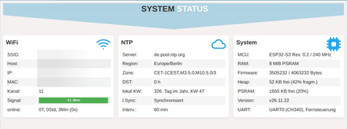
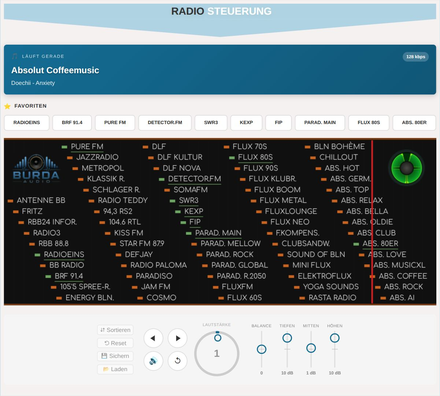
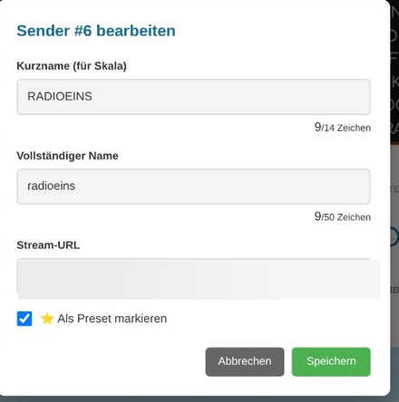
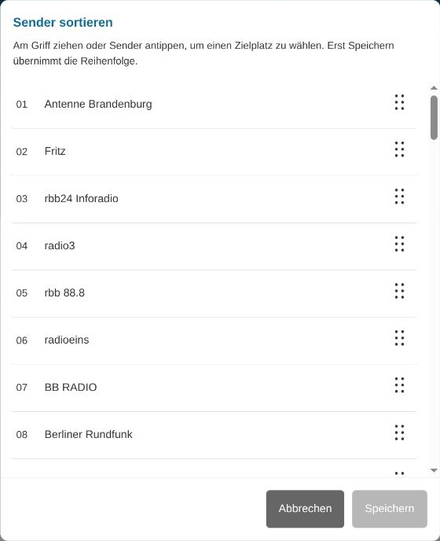
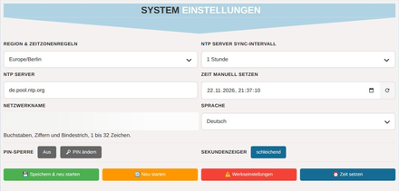
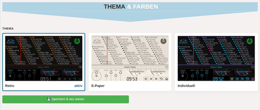
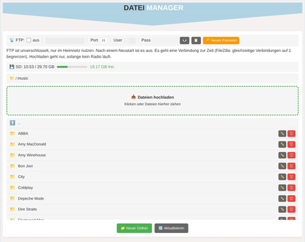
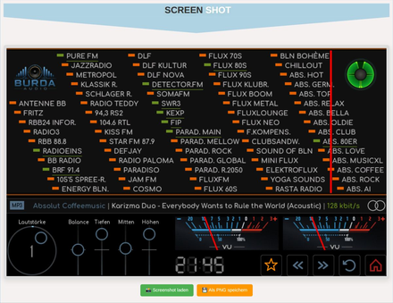

# Weboberfläche

[RetroRadioCrowPanelS3](../README.md) > [Dokumentation](../README.md#dokumentation) > Weboberfläche

## Aufrufen und anmelden

> **Start-PIN: 0000 – vier Nullen.** Bei einer frischen Einrichtung gilt sie auch im Browser. Hast Du am Gerät bereits eine eigene PIN gespeichert, verwendest Du diese.

Verbinde Computer oder Smartphone mit demselben Heimnetz wie das Radio. Öffne im Browser **`http://<IP-Adresse-des-Radios>`**. Die Adresse steht im Hauptmenü und unter **Einstellungen -> Info**. Verwende die IP-Adresse, wenn die Namensauflösung im Heimnetz nicht funktioniert.

Bei eingeschalteter PIN-Sperre erscheint zuerst das Tastenfeld. Es gilt dieselbe vierstellige PIN wie am Display. Eine falsche Eingabe verzögert den nächsten Versuch. Bei ausgeschalteter PIN-Sperre öffnet sich das Portal unmittelbar. Die PIN ist eine Zugangssperre für das Heimnetz, die Verbindung nutzt HTTP. Leite das Portal und FTP nicht ins Internet weiter.

Über das **Schloss** meldest Du Dich ab. Eine Sitzung gilt 30 Minuten. Wird das Gerät erneut gesperrt, ist auch im Browser eine neue Anmeldung nötig. Ab dem fünften Fehlversuch beginnt eine Wartezeit von einer Minute. Weitere Fehlversuche verlängern sie bis auf höchstens 60 Minuten.

Die Navigation führt zu **Status**, **Radiosteuerung**, **System**, **Thema**, **Dateien** und **Screenshot**. **Radiosteuerung erscheint nur, solange das Radio am Gerät geöffnet ist.** Das Portal startet keine anderen Gerätemodule. Auf schmalen Bildschirmen passt sich die Anordnung an. Deutsch und Englisch folgen der am Gerät gespeicherten Sprache.

## Status

Die Startseite zeigt WLAN, Netzwerkname, IP- und MAC-Adresse sowie Firmwareversion, Laufzeit, Speicher und Uhrzeit. Diese Angaben helfen bei der Zuordnung des Geräts. Private Netzwerkangaben sind in den folgenden Aufnahmen unkenntlich gemacht.

## Radio und Senderverwaltung

Öffne zuerst das Radio am Display. Im Webbereich **Radiosteuerung** stehen Senderskala, Wiedergabestatus, Lautstärke, Balance und Klangregler zur Verfügung. Die Skala folgt der Auswahl am Gerät. Sender können im Browser ausgewählt werden, die Pfeile wechseln zum vorherigen oder nächsten Sender. Lautstärke und Stummschaltung wirken unmittelbar.

Klicke auf die kleine Markierung eines Senderplatzes und anschließend auf den Stift, um den Senderdialog zu öffnen. Ein Doppelklick auf die Markierung startet den Sender direkt. Der **Kurzname** für die Skala hat höchstens 14 Zeichen, der **vollständige Name** höchstens 50 Zeichen. Trage eine direkte **Stream-URL** ein, keine normale Webseite des Senders. **Als Preset markieren** nimmt den Sender in die bis zu zehn Favoriten auf. **Speichern** überträgt den Eintrag an das Radio, **Abbrechen** verwirft die Eingabe.

Das Aktionsmenü am Sendermarker bietet **Aufrufen**, **Bearbeiten** und **Löschen**. Auf einem Touch-Bildschirm öffnet der erste Tipp das Menü, ein zweiter Tipp auf denselben Sender startet ihn. Löschen leert den ausgewählten Senderplatz nach Rückfrage.

### Reihenfolge und Sicherung

**Sender sortieren** öffnet die Liste aller 70 Plätze. Ziehe einen Eintrag am Griff oder tippe ihn an und gib den Zielplatz an. Die Einträge dazwischen rücken nach, es wird kein Sender überschrieben. Erst **Speichern** übernimmt die neue Reihenfolge auf das Radio. **Abbrechen** lässt die gespeicherte Liste unverändert.

Bei Eingabe eines Zielplatzes bestätigst Du zunächst mit **Übernehmen**. **Zurück** verwirft nur diese Zielwahl. Erst das abschließende **Speichern** sendet die gesamte Reihenfolge an das Gerät. Meldet das Portal einen Konflikt mit einer inzwischen geänderten Senderliste, öffne den Sortierdialog erneut und arbeite mit dem aktuellen Stand.

**Sichern** lädt eine JSON-Datei mit allen 70 Senderplätzen und den Favoriten auf Deinen Computer. Über **Laden** wählst Du eine solche Datei wieder aus. Vor der Übernahme zeigt das Portal die Zahl belegter Plätze und Favoriten. Erst Deine Bestätigung ersetzt die vorhandene Liste. Bewahre vor einem Import eine Sicherung auf. Persönliche Streamadressen oder Zugangsdaten gehören nicht in öffentlich geteilte Senderlisten.

Die Rücksetzung der **Senderliste** lädt nach Bestätigung die mitgelieferten Sender. Der Kreispfeil bei den Klangreglern setzt dagegen Lautstärke und Klang zurück. Das sind getrennte Aktionen.

## System und Zeit

Unter **System** bearbeitest Du Zeitzone, Zeitserver, Synchronisationsintervall, Netzwerkname und Sprache. **Speichern & neu starten** übernimmt diese Einstellungen und startet das Gerät neu. Für eine manuelle Uhrzeit gibt es das Datumsfeld, eine Schaltfläche zum Übernehmen der Browserzeit und **Zeit setzen**.

Die PIN-Sperre, die PIN und der Sekundenzeiger haben eigene Bedienelemente. Diese Änderungen sind von der allgemeinen Speichertaste getrennt. **Neu starten** startet nur die Firmware neu. **Werkseinstellungen** setzt gespeicherte Einstellungen nach Rückfragen zurück, sichere vorher Deine Senderliste und notiere die notwendigen WLAN-Daten.

Zum Ausschalten der PIN-Sperre gibst Du die bisherige PIN ein und bestätigst **Ausschalten**. Zum Ändern trägst Du alte und neue PIN ein und drückst die zugehörige Speichertaste. Der Sekundenzeiger wechselt sofort zwischen schleichender Bewegung und Sekundenschritten.

## Thema und Farben

**Retro**, **E-Paper** und **Individuell** sind die drei Gerätethemen. Die Vorschaukacheln helfen bei der Wahl. Bei **Individuell** lassen sich Akzent- und Textfarben auswählen. **Speichern & neu starten** aktiviert das Thema auf dem Display.

Für **Individuell** stehen 18 Grundfarben zur Auswahl. Wähle die gewünschte Farbe und beurteile sie in der Live-Vorschau. Grund- und Flächenfarben sind festgelegt. **Vorgabe wiederherstellen** setzt die individuellen Farben zurück. Beachte den Bestätigungsdialog, über den die Vorgabe auch unmittelbar gespeichert und das Gerät neu gestartet werden kann.

Das Farbschema unten im Browser und die Hell-/Dunkel-Schaltfläche ändern dagegen nur die Darstellung des Webportals im jeweiligen Browser.

## Dateimanager und FTP

Beende für die Dateiverwaltung zuerst Radio und SD-Wiedergabe. **Dateien** zeigt den Inhalt der SD-Karte, den aktuellen Pfad und den verfügbaren Speicher. Öffne einen Ordner über seinen Namen. Dateien können hochgeladen, heruntergeladen, umbenannt und gelöscht werden, neue Ordner lassen sich anlegen. Zum Hochladen klickst Du in die Uploadfläche oder ziehst Dateien darauf. Ein Web-Upload ist auf **32 MiB je Datei** begrenzt. Die angebotenen Aktionen hängen vom aktuellen Zugriff auf die Karte ab.

Über die Pfadleiste wechselst Du in einen übergeordneten Ordner. Existiert eine hochgeladene Datei bereits, fragt das Portal vor dem Ersetzen nach. Beim Löschen eines Ordners wird auch dessen Inhalt entfernt. Die Bestätigung nennt die betroffenen Einträge, prüfe sie vor dem Fortfahren.

Laufende oder angeforderte SD-Wiedergabe sowie andere Dateiübertragungen können die Karte belegen. Das Portal zeigt den Grund an, wenn eine Aktion gerade nicht verfügbar ist. Beende den konkurrierenden Zugriff und aktualisiere die Dateiliste. Schließe Dateiverbindungen, bevor Du die SD-Wiedergabe wieder startest.

FTP wird oben im Dateimanager eingeschaltet. Adresse, Port, Benutzername und Passwort stehen daneben. Das Passwort ist zunächst verdeckt, die Schaltflächen erlauben Anzeigen und Kopieren. **Neues Passwort** ersetzt das bisherige und trennt eine angemeldete FTP-Verbindung. Nach einem Neustart ist FTP wieder ausgeschaltet.

Für einen FTP-Client gelten **Port 21**, **Passivmodus (PASV/EPSV)**, unverschlüsseltes FTP im Heimnetz und **höchstens eine gleichzeitige Verbindung**. Begrenze dies beispielsweise in FileZilla auf 1. Übertrage große Musikbestände besser mit einem Kartenleser. FTP ist kein Musikstreaming-Zugang.

Der Benutzername ist **crow**. Für passive Datenverbindungen verwendet das Gerät die Ports **50000 bis 50003**. FTP-Uploads sind bei laufendem Radio gesperrt. Downloads können während Radio möglich sein, werden aber durch SD-Wiedergabe oder andere Belegungen der Karte blockiert. Für eine ungestörte Dateiübertragung beendest Du deshalb die Wiedergabe zuvor.

## Bildschirmaufnahme

**Screenshot laden** liest das aktuelle Displaybild mit 800 × 480 Pixeln ein. **Als PNG speichern** lädt die Aufnahme auf den Computer. Das ist eine Einzelaufnahme, keine laufende Videoübertragung und keine Touch-Fernsteuerung. Auch bei laufendem Radio kann eine Aufnahme erstellt werden.

Warte, bis das Bild vollständig geladen ist, und speichere es dann als PNG. Während der Aufnahme halten Anzeige und Touch-Verarbeitung kurz an, der Ton läuft weiter. Für einen neuen Bildschirmstand klickst Du erneut auf **Screenshot laden**.

Vor dem Teilen von Bildern WLAN-Namen, Netzwerkadressen, Passwörter und andere private Angaben unkenntlich machen. Die dokumentierten Radio- und SD-Aufnahmen entstanden bei Lautstärke 1.

[RetroRadioCrowPanelS3](../README.md) > [Dokumentation](../README.md#dokumentation) > Weboberfläche
